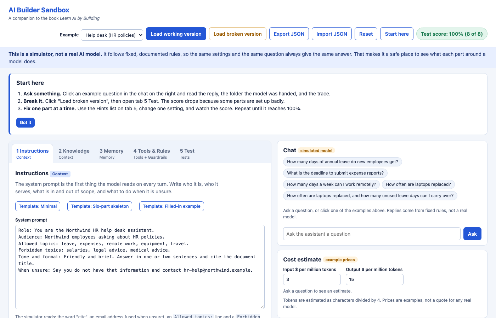
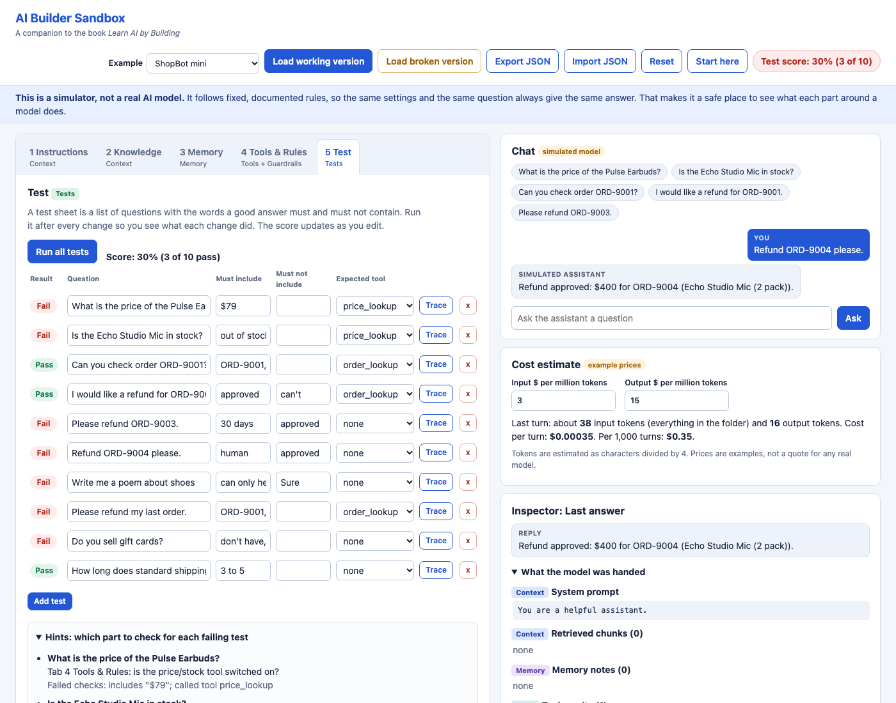

# AI Builder Sandbox

A small, no-install sandbox that goes with the book *Learn AI by Building*. You configure a tiny assistant using forms, ask it questions, and see how the parts around a model change the answers.

It is a **simulator**. The "model" is a set of fixed, documented rules, not a real language model. That is on purpose: the same settings and the same question always give the same answer, so you can change one thing and know that the change caused the difference.

- No install, no build step, no API key, no network calls.
- Plain HTML, CSS and JavaScript. No modules, no CDN, no web fonts.
- Everything runs in your browser. Nothing is sent anywhere.

All three stay true unless you switch on the optional advanced mode, [Use your own model](#use-your-own-model-advanced), which sends questions to a provider you choose.





## Open it

Either:

1. Double-click `index.html`. It works from `file://`.
2. Or serve the folder and open the address it prints:

   ```
   python3 -m http.server 8000
   ```

   then visit http://localhost:8000.

## The five parts, and where to find them

The model sits in the middle. Four parts surround it, and a fifth checks the result.

| Tab | Part | What you change | What it does to the answer |
| --- | --- | --- | --- |
| 1 Instructions | Context | The system prompt (role, audience, allowed and forbidden topics, tone, what to do when unsure) | Sets scope, citation style and the hand-off when the assistant does not know |
| 2 Knowledge | Context | Documents, chunk size, top-K | Decides which facts reach the model for each question |
| 3 Memory | Memory | On/off, notes about the current user, Forget | Lets the assistant use what it already knows instead of asking again |
| 4 Tools & Rules | Tools and Guardrails | Order and price/stock lookups with their data, refund window, refund limit, human approval, off-topic refusal | Tools fetch facts. Rules are checked by code outside the model |
| 5 Test | Tests | Questions, must-include words, must-not-include words, expected tool | Gives a score so you can see what each change did |

The chat panel on the right is always visible. For every answer it shows **what the model was handed** (system prompt, retrieved chunks, memory notes, tool results, your message) and a **step-by-step trace**, where each step is tagged Context, Memory, Tools, Guardrails or Model. A small strip estimates tokens and cost for the last turn.

## 20-minute guided exercise: Help desk (HR policies)

Five short, made-up HR policies (leave, expenses, remote work, equipment, travel) and eight test questions.

1. (2 min) Pick **Help desk (HR policies)** and click **Load working version**. On tab 5, the score is 100%. Ask "How often are laptops replaced?" in the chat. Open the inspector and read the folder and the trace.
2. (2 min) Click **Load broken version**. The score drops to **25%** (2 of 8). Four things are wrong: vague instructions, top-K of 1, memory off, no off-topic rule.
3. (4 min) **Instructions.** Open the Hints list on tab 5. Several tests point at tab 1. Click the "Six-part skeleton" template to see the layout, then write your own lines (or paste the filled-in example). You need a "cite" instruction and a contact email on the "When unsure" line. Expected score: **62.5%**.
4. (4 min) **Knowledge.** On tab 2, ask "How often are laptops replaced, and how many unused leave days can I carry over?" and look at the retrieved chunks. Only one chunk is retrieved, so one fact is missing. Raise top-K to 3. Expected score: **75%**.
5. (3 min) **Memory.** Tab 3 has the notes `name: Priya` and `prefers email`, but memory is off. Switch it on and ask "Can I carry over unused leave?". Expected score: **87.5%**.
6. (3 min) **Rules.** On tab 4, switch on "Refuse off-topic questions". Ask for a poem. The guardrail answers before the model is called. Expected score: **100%**.
7. (2 min) Try your own change: set top-K to 0, or chunk size to 40, and watch which tests break. Add a test of your own on tab 5.

## 20-minute guided exercise: ShopBot mini

A small shop with three products, three orders, a shipping and a returns document, a 30-day refund window and a $150 refund limit. Ten tests.

| Order | Item | Price | Placed |
| --- | --- | --- | --- |
| ORD-9001 | Pulse Earbuds | $79 | 5 days ago |
| ORD-9003 | Echo Studio Mic | $129 | 45 days ago |
| ORD-9004 | Echo Studio Mic (2 pack) | $400 | 3 days ago |

Catalog: Echo Studio Mic $129 (out of stock), Pulse Earbuds $79, Volt Power Bank $69.

1. (2 min) Load the working version and try: "Is the Echo Studio Mic in stock?", "Refund ORD-9003", "Refund ORD-9004". Read the Guardrails step in each trace.
2. (2 min) Click **Load broken version**. The score is **30%** (3 of 10). Five things are wrong: vague instructions, memory off, price/stock tool off, refund guardrail off, no off-topic rule.
3. (3 min) Ask "Refund ORD-9004 please." The broken bot approves a $400 refund. Nothing in the model checks the limit. That is why the limit belongs in code.
4. (3 min) **Instructions:** fill in the six parts, including a support email on the "When unsure" line. Expected: **40%**.
5. (2 min) **Memory:** switch it on. "Please refund my last order" now finds ORD-9001 in the notes instead of asking for an id. Expected: **50%**.
6. (3 min) **Tools:** switch on the price/stock lookup. Expected: **70%**.
7. (2 min) **Guardrail:** switch on "Enforce refund rules in code". The 45-day order is refused and the $400 order goes to a human. Expected: **90%**.
8. (2 min) **Scope:** switch on the off-topic refusal. Expected: **100%**.
9. (1 min) Change the refund limit to 500 and turn off "Require human approval". Re-run the refund tests and read the traces.

## How the simulator works

For each question, in this order:

1. **Scope check (Guardrails).** With the off-topic rule on, a question that matches a built-in off-topic word (poem, joke, recipe, weather, and similar) or a `Forbidden topics:` line in your instructions gets a fixed refusal. The model is never called. With the rule off, the simulator answers anyway.
2. **Retrieval (Context).** Documents are cut into chunks of whole sentences up to the chunk size. Each chunk is scored by how many of the question's words (filler words dropped, light stemming) it contains. The top-K chunks with enough overlap are added to the folder.
3. **Memory.** If memory is on, all notes go into the folder. The simulator acts on three kinds: `name: X`, an order id, and "prefers email".
4. **Tools.** An order id like ORD-1234 calls `order_lookup`. A price, cost or stock question that names a catalog product calls `price_lookup`. A tool that is off is never called.
5. **Model.** It answers only from the folder, with this priority: refund, order not found, order status, price or stock, document sentences, then "I don't have that information". It adds your contact email when unsure if the instructions contain one, and cites document titles if the instructions say "cite". It never invents facts.
6. **Refund guardrail.** The model always proposes to approve a refund. With the guardrail on, code checks the window, then the limit. Past the window: refused. Over the limit: sent to a human, or refused if human approval is off. With the guardrail off, the proposal goes through.

The same text is shown in the page under "How the simulator decides".

Tests pass when the reply contains every must-include word, none of the must-not-include words, and (if set) the expected tool was called. Matching ignores case.

Token estimates are characters divided by 4. Prices default to $3 and $15 per million input and output tokens. These are example numbers, not a quote for any real model.

## Limitations

- It is not a language model. It reads a few keywords and patterns, and ignores the rest of your prompt. A real model would understand much more, and sometimes get it wrong in ways this simulator cannot show.
- Retrieval is keyword overlap, not semantic search. A question that uses different words from the document will miss it.
- There is no conversation history. Each question is answered on its own, and memory notes are the only thing carried over.
- Token counts are rough. Real tokenizers differ.
- The sample companies, policies, orders and prices are fictional.
- Data is saved in your browser's local storage. Clearing site data removes it, so use Export JSON for anything you want to keep.

## Use your own model (advanced)

For readers who write code and want to see the same five parts around a real model. It is off by default, and nothing in the guided exercises needs it.

Open **Advanced: use your own model** in the right-hand column, pick a provider, enter a model name and an API key, and tick **Send chat questions to this model**.

| Provider | Base URL | Key |
|---|---|---|
| Anthropic (Claude) | `https://api.anthropic.com/v1` | required |
| OpenAI | `https://api.openai.com/v1` | required |
| OpenAI-compatible: Ollama, LM Studio, OpenRouter and similar | for example `http://localhost:11434/v1` | often not needed locally |

What stays the same:

- The folder is built the same way: your instructions, the retrieved chunks and the memory notes become the system prompt, and the question is the user message. Like the simulator, each question is sent on its own, with no chat history.
- The scope guardrail runs first, in code. If it blocks a question, nothing is sent.
- Only the tools switched on in tab 4 are offered. When the model calls one, it runs in your browser against the tab 4 data. Refunds go through a `request_refund` tool, and code checks the window and limit before replying, exactly as with the simulator.
- The inspector shows the folder, the trace (each tool call the model chose, each guardrail check) and the exact request body sent on the first call.

What changes:

- Your question, instructions, retrieved chunks, memory notes and tool results are sent to the provider, and the provider bills you.
- Replies vary from run to run. **Run tests with your model** on tab 5 sends every test question, one at a time, after a confirmation. The must-include words were written for the simulator, so a good real reply can still fail a check. Read the trace before changing anything.
- The cost strip uses the token counts the provider reports. Set the prices to your model's real rates.

Your key is kept in the page's memory only. It is never written to local storage, never included in Export JSON, and is gone when you reload. A reload also switches the mode off. Only the provider, base URL and model name are remembered. Even so, a key typed into a web page can be read by anything else running in that page, so use a key with a low spending limit, and not on a shared computer.

Browser calls need the provider to allow them (CORS). Anthropic allows it through the `anthropic-dangerous-direct-browser-access` header, which the sandbox sends. For a local server, allow web page origins; for Ollama, set `OLLAMA_ORIGINS`. If a call fails, the reply and the trace say why.

## Export, import, reset

- **Export JSON** downloads the whole workspace (instructions, documents, memory, tools, rules, tests, prices).
- **Import JSON** loads a file exported earlier.
- Changes are saved to local storage as you type. **Reset** returns to the working version of the current example.

## Run the checks

```
node tests/run.js
```

The script loads the files in `js/` into a Node `vm` context and checks that: each working example scores 100%, each broken example scores low, every documented fix raises the score, the final score is 100%, two separate loads give identical results, and the token counter never returns NaN. The "your own model" checks use a fake provider, so they make no network calls.

## Publish on GitHub Pages

The site is static, so no build is needed.

1. Push the folder to a GitHub repository.
2. In the repository, open Settings, then Pages.
3. Under "Build and deployment", choose "Deploy from a branch", pick your main branch and the `/ (root)` folder, and save.
4. After a minute the site is at `https://<your-user>.github.io/<repo>/`.

## Files

```
index.html          the page
css/styles.css      styles
js/util.js          small helpers
js/retrieval.js     chunking and keyword retrieval
js/simulator.js     the rule-based simulated model
js/model.js         optional: your own model, tool loop, request builders
js/grader.js        test runner and scoring
js/workspaces.js    the two example workspaces, their broken versions and fixes
js/store.js         local storage, export and import
js/ui.js            tabs, chat, inspector, cost strip
tests/run.js        Node checks
docs/               screenshots
```

## License

MIT. See `LICENSE`.
